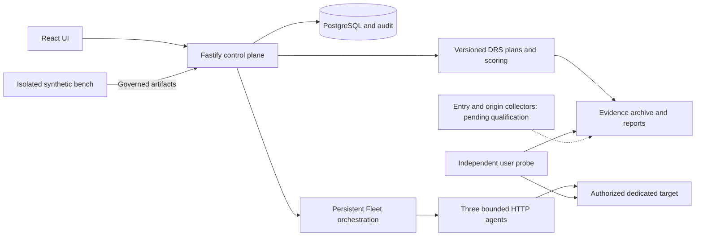

# Architecture

The deployed control plane is Node/TypeScript ESM, Fastify, PostgreSQL and static React/Vite assets. `backend/src/app.ts` composes routes and injected dependencies; `server.ts` configures runtime services, policy and shutdown. `frontend/src/context.tsx` uses server capabilities rather than a second role matrix.

## Reused components

- `modules/campaigns/`: campaign persistence, approvals, scheduling, bounded dispatch, stop and historical results.
- `modules/drs/`: immutable reference, catalogue, plan revisions, orchestrator ports, baseline, evidence validation, scoring and JSON/HTML reports.
- `modules/fleet/` and `agents/persistent-fleet.ts`: inventory, identities, missions, progress, shared budgets and archived receipts.
- `modules/probe/`: independent HTTP observation and quality diagnostics. Functional journeys still need collectors.
- `modules/reports/`, `modules/wrs/`, metrics and audit: diagnostics, exports, operational history and provenance; WRS stays separate from DRS.
- `store/`: transactional persistence and migrations; memory fixtures are development-only for legacy team mode.
- `modules/assistant/`: capability-governed context and proposals; it cannot bypass approval, target or rate policy. Kusa is not a qualified provider yet.

## Execution boundaries

Persistent missions operate on already provisioned agents; a Fleet inventory entry is not a Kubernetes deployment. The older Job coordinator is a separate adapter, disabled on production. Kubernetes manifests are in `deploy/kubernetes/`; the synthetic network bench belongs to the companion repository.

A plan revision freezes scope, instrumentation, budgets and standard hash. Generator and collector ports are separate. The state machine, stop acknowledgments and recovery prevent silent progression when proof is missing. See [DRS engine](drs-engine.md) and [Fleet contract](fleet-missions.md).

[Current topology](current-setup.md) records deployed versions independently from repository history. Images, API build identity, UI assets and evidence hashes must be checked before promotion.
